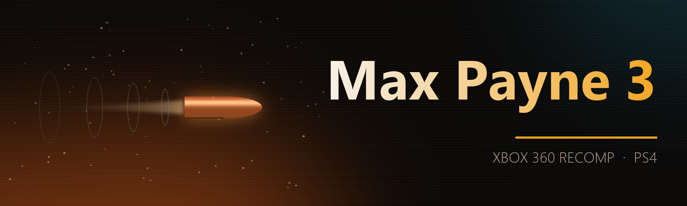

<p align="center">
  
</p>

<p align="center">
  <a href="https://github.com/iHaiDeeZ/MP3-PS4/releases/latest"></a>
  
  
  
  <a href="LICENSE"></a>
  <a href="https://discord.gg/fqjMs9gDJh"></a>
</p>

<h3 align="center">Max Payne 3, recompiled to run natively on the PS4.</h3>

<p align="center">
  <a href="https://github.com/iHaiDeeZ/MP3-PS4/releases/latest"><b>⬇ Get the latest release</b></a> ·
  <a href="#getting-started">Getting started</a> ·
  <a href="#controls">Controls</a> ·
  <a href="#the-quick-menu">Quick menu</a> ·
  <a href="#faq">FAQ</a> ·
  <a href="https://discord.gg/fqjMs9gDJh">Discord</a> ·
  <a href="CREDITS.md">Credits</a>
</p>

---

## Overview

MP3-PS4 brings [mp3-nx](https://github.com/VasilkovND/mp3-nx), VasilkovND's native Switch port of the Xbox 360
version of **Max Payne 3** (Rockstar Studios, 2012), to jailbroken PS4 consoles. There's no emulator: the PowerPC code
of the game's `default.xex`, with Title Update 6, is statically recompiled to C++ by
[ReXGlue](https://github.com/rexglue/rexglue-sdk) on your PC and compiled for the PS4's CPU. The game's Direct3D calls
are drawn by Renut, the renderer of the [Metal Gear Rising port](https://github.com/iHaiDeeZ/MGR-PS4), through plume's
**Vulkan** back end, on Mesa's RADV driver adapted to the PS4's AMD GPU.

It's a full x86-64 conversion: none of the Switch port's ARM code (NEON audio, deko3d renderer) is carried over. The
PS4 runs the SDK's x86-64 paths, built for its Jaguar CPU, with a PS4 platform layer of its own.

It installs as an app on the home screen and plays with a DualShock 4. **L3 + R3** opens a quick menu with a frame
counter and the diagnostics.

**You bring your own game.** Nothing copyrighted is in this repository or its releases: no game code, art or sound.
The package you build holds code made from your `default.xex` (and, if you choose, your game's files), so it's for
your console only.

## Highlights

**The whole game, natively**
- The game's PowerPC code recompiled ahead of time and built for the PS4's Jaguar cores: no interpreter, no JIT.
- mp3-nx's code generation passes (guest registers as C++ locals, inlining, stack accesses), plus the PS4's own: the
  physical memory window's offset taken once per base register, and PowerPC's fused multiply-adds as a multiply and
  an add (the Jaguar has no FMA unit).
- The game's threads with their own priorities and cores, the busy ones spread over the PS4's seven cores.
- The game's audio update no longer waits for its audio thread (which held busy fights at ~12 fps), and XAudio2's
  mono-to-5.1 mixer runs in SSE, bit for bit as the original.

**The picture**
- Renut draws the game's Direct3D 9 calls itself on Vulkan: its HDR targets and exposure, the G-buffer the game draws
  in two tiles, its 4x-aliased resolves.
- The game's 3,824 shaders translated to SPIR-V when you build, from the shaders your console captured.

**One package**
- `MP3_PKG_GAME=1` puts your game and Title Update 6 inside the package (8.2 GB): one install, nothing to copy to the
  console's `/data/MP3`.
- Your own `sce_sys/icon0.png` and `pic1.png`, if you make them, go into your package.

**When something goes wrong**
- A log for every session, ps4-kit's boot trace and crash log, and a freeze report with every thread's stack, in
  `/data/MP3/`.
- Diagnostics you can switch off in the menu: a report of the game's long waits, CPU profiles (on demand, or by
  themselves when gameplay stays slow).

## Status

| | |
|---|---|
| Boots, menus, title, gameplay | yes |
| Picture | right since v00.44 (Renut) |
| Frame rate | menus and calm gameplay at the game's 30 fps cap; busy fights 15-25 fps |
| Sound | works; some crackle and distortion remain (being looked at) |
| Known issues | Xbox Live prompts still in the menus; Xbox button icons in this build (the PlayStation icons work only in the Xenos build) |
| Tested on | one PS4 (base model) with GoldHEN |

## Getting started

**You need:** a jailbroken PS4 with **GoldHEN** and an FTP connection to it; a PC with **WSL 2** (Ubuntu, 16 GB of
RAM, about 40 GB free); the **OpenOrbis** toolchain (PacBrew); and your **own** copy of **Max Payne 3** for Xbox 360:

- **Disc 1**, as the folder of its files (disc 2 isn't needed);
- **Title Update 6**, the file `tu00000006_00000000`.

Together they make version **0.0.6.6** of the game: `default.xex` with SHA-1 `d36c6b8e6afc796b4c82f831aff6bf41ba494e6a`
and Title Update 6's `default.xexp` with SHA-1 `6370fad01ff3820641888ab71918e52c11917922`. The code generator's
configuration (`codegen/`) is made for these files; other versions aren't supported.

> **Note:** the build also needs **ps4-kit** in `~/ps4-kit`, the shared PS4 base of these ports (toolchain setup,
> runtime, Mesa RADV for the PS4, VideoOut swapchain, packaging). This release was built with ps4-kit `56b3d86`;
> ps4-kit isn't published yet.

### Building the package

1. Install the host tools in WSL (clang 21 from [apt.llvm.org](https://apt.llvm.org) if your Ubuntu doesn't have it):

   ```bash
   sudo apt install clang-21 lld-21 llvm-21 cmake ninja-build git rsync curl python3 python3-pil
   ```

2. Get the sources at the commits this port is built on, with its patches applied (into `~/mp3-build/src`):

   ```bash
   scripts/clone-mp3.sh
   ```

3. Put your game in place: disc 1's files in `~/mp3-build/game`, and Title Update 6's files (with upstream's
   extractor) in `~/mp3-build/stage-tu/update`, its `default.xexp` next to `default.xex`:

   ```bash
   python3 ~/mp3-build/src/mp3-nx/mp3/tools/stage_sd.py --tu /path/to/tu00000006_00000000 -o ~/mp3-build/stage-tu
   cp ~/mp3-build/stage-tu/update/default.xexp ~/mp3-build/game/
   ```

4. Build the tools and the game's code, from this repository's folder in WSL:

   ```bash
   scripts/build-mp3.sh sdk
   scripts/build-mp3.sh host
   scripts/build-mp3.sh codegen
   ```

5. The shaders, once. Build a first package with the Xenos emulation (no Renut yet), install it and start the game:
   it writes every shader the game makes at startup to `/data/MP3/shader_capture` (the menu's **Capture shaders**,
   on by default). Then fetch and translate them:

   ```bash
   MP3_VERSION=00.51 scripts/build-mp3.sh app && MP3_VERSION=00.51 MP3_PKG_GAME=1 scripts/build-mp3.sh pkg
   # install it, start the game once, then:
   PS4_HOST=YOUR_PS4_IP scripts/build-mp3.sh captures
   scripts/build-mp3.sh shaders
   ```

6. The package with Renut:

   ```bash
   MP3_RENUT=1 MP3_VERSION=00.51 scripts/build-mp3.sh app
   MP3_RENUT=1 MP3_VERSION=00.51 MP3_PKG_GAME=1 scripts/build-mp3.sh pkg
   ```

   `pkg` makes **`out/MP3-v00.51.pkg`** (title ID `MAXP00003`). With `MP3_PKG_GAME=1` your game and Title Update 6
   are inside it (8.2 GB); without it the package is about 130 MB and the game goes to the console's `/data/MP3`:

   ```bash
   py scripts/upload-data.py --host YOUR_PS4_IP
   py scripts/upload-data.py \\wsl.localhost\Ubuntu\home\YOU\mp3-build\stage-tu\update --update --host YOUR_PS4_IP
   ```

7. Copy the package to the console (FTP to `/data/pkg`) and install it with GoldHEN's **Package Installer**.

> **Tip:** `codegen` takes about 6 minutes and `app` about 1.5 GB of RAM per compile job. An interrupted
> `upload-data.py` resumes where it stopped.

**Updating:** build the newer version and install it on top of the old one. Your saves and settings in `/data/MP3/`
stay.

## Controls

| DualShock 4 | Xbox 360 controller |
|---|---|
| Cross / Circle / Square / Triangle | A / B / X / Y |
| L1 / R1 | LB / RB |
| L2 / R2 | Left / right trigger |
| OPTIONS | Start |
| Touch pad click | Back |
| Left / right stick | Left / right stick |
| L3 / R3 | Stick buttons |
| D-pad | D-pad |
| **L3 + R3** | Open or close the quick menu |

## The quick menu

**L3 + R3** while playing (again, or **Circle**, to close it). The D-pad or the left stick moves, **Cross** picks.
Changes are saved to `/data/MP3/mp3.toml` when the menu closes. Pause the game with **OPTIONS** first: it keeps
running behind the menu.

| Tab | Row | Choices |
|---|---|---|
| OVERLAY | Frame counter | **Off**, FPS, Detailed (frame times and a graph of the last 120 frames) |
| | Position | **Top left**, Top right |
| DIAGNOSTICS | Long-wait log | **On**, Off: game threads waiting 2 s or more, in the log |
| | Record a CPU profile | 8 s of play after the menu closes, every thread, to `/data/MP3/profiles/` |
| | Profile slow gameplay | **On**, Off: once a session, a profile by itself when the game stays slow |
| | Capture shaders | **On**, Off, in the Xenos build: every shader the game makes, to `/data/MP3/shader_capture/` (the Renut package writes there by itself the ones its library lacks) |
| | Freeze report | **On**, Off: every thread's stack in `/data/MP3/hang.log` when no frame comes for 15 s |
| | Renderer HDR log | On, **Off**: what the tonemap and luminance passes read, for picture reports |
| VIDEO | Frame rate, 60 FPS method, Light occlusion, GPU particle readback | the Xenos emulation's settings: no effect in the Renut package |
| ABOUT | | the build, the game, the CPU and GPU paths |

The defaults are in bold.

## Your files

Everything sits in **`/data/MP3/`**:

- `game/`, `update/`: your game and Title Update 6, if they aren't in the package
- `mp3/`: the Xbox 360 profile and your saves
- `mp3.toml`: the settings (the quick menu writes it)
- `logs/mp3_NNN.log`: one log for every session
- `boot-trace.log`, `crash.log`, `hang.log`: ps4-kit's start-up trace, crash record and freeze reports
- `cache/`, `pipeline_list.bin`: the game folder's index and the Vulkan pipeline cache
- `shader_capture/`: shaders the game made (they go into the next build's shader library)
- `profiles/`: the CPU profiles

## FAQ

**Why isn't there a package to download?**
The package holds code recompiled from the game and its translated shaders, and with `MP3_PKG_GAME=1` the game
itself. You build it from your own copy; the releases are source only.

**Which version of the game works?**
Disc 1 with Title Update 6 (version 0.0.6.6), with the hashes above: the recompiled code is made for them.

**Why 30 fps?**
The game caps itself at 30, on the 360 too, and the renderer keeps that pace.

**Why does it slow down in big fights?**
The PS4's CPU is the limit there: the game's main thread updates the world (physics, AI, animation) on a 1.6 GHz
Jaguar core, spread over hundreds of functions with no single hot spot. The renderer and the GPU have time to spare.

**What's in the one-file package?**
With `MP3_PKG_GAME=1`, disc 1's files (without the dashboard extras) as `game/` and Title Update 6's as `update/`.
The app reads them from the package before `/data/MP3`; a package without them uses `/data/MP3` as before.

**How do I report a bug?**
On [Discord](https://discord.gg/fqjMs9gDJh) or in an [issue](https://github.com/iHaiDeeZ/MP3-PS4/issues). Attach the
newest `logs/mp3_NNN.log`, `boot-trace.log` and, if there are any, `crash.log` and `hang.log` from `/data/MP3/`, with
the version, what you were doing, your PS4 model and firmware.

## How it works on the PS4

| Part | PS4 |
|---|---|
| Game code | ReXGlue's generator writes C++ from `default.xex` and Title Update 6's `default.xexp` on your PC (mp3-nx's passes plus the PS4's); ps4-kit's clang 21 builds it for the Jaguar (`-march=btver2`) |
| Guest memory | the 360's address window reserved at once; physical memory is PS4 direct memory, mapped on first use and aliased into every mirror; the `0xE0000000` view 4 KB higher, as on Windows |
| Threads | guest threads on PS4 pthreads at the game's own priorities and cores; a balancer spreads the busy ones over seven cores every second; the renderer's thread alone on the seventh |
| Renderer | Renut (the game's Direct3D 9 calls) on plume's Vulkan back end, Mesa RADV through ps4-kit, VideoOut swapchain at 1920x1080 |
| Shaders | XenosRecomp turns the game's 3,824 shader containers into SPIR-V at build time; RADV's pipelines are cached in `/data/MP3` |
| Sound | `sceAudioOut`; XMA decoded with FFmpeg on a worker thread |
| Pad | `scePad` (DualShock 4); the same pad drives the quick menu through ImGui |
| Files | the game from the package (`/app0`) or `/data/MP3`; the 360's storage is `/data/MP3/mp3` |

Findings on the way that matter for other ports of this SDK:

- **Thread priorities and cores.** The SDK ignored the game's thread priorities and affinities by default, so every
  game thread ran at one priority on any core. The PS4 doesn't take turns between threads of one priority: a busy
  thread keeps its core. Applying both took busy fights from 4-5 to 13-17 fps.
- **A wait in the game's own audio update.** It waited, in sleeps, until RAGE's audio thread had taken the last
  update; that thread waited for XAudio2's lock. The game has its own switch for going on without the wait
  (`0x83705DF8`): busy fights went from ~12 to ~18.5 fps.
- **Constants the GPU loads.** The tonemap's exposure isn't set by the CPU: Direct3D tells the GPU to load it from a
  1x1 resolve (`LOAD_ALU_CONSTANT`), a packet Renut never saw. A hook copies it into the device's constants.
- **Predicated tiling.** The G-buffer is drawn in two 1280x384 tiles and resolved per tile from the game's own list
  of rectangles: the tiles are kept, with targets of the full size.
- **The physical window's offset.** With 64 KB granularity the `0xE0000000` view sits 4 KB higher on the PS4, as on
  Windows: hooks must read guest memory through `GuestPtr`, never `base + address`.

More in **[docs/DEVELOPMENT.md](docs/DEVELOPMENT.md)**.

## Good to know

- Busy fights run at 15-25 fps: the main thread's own work, measured above.
- The VIDEO tab's settings belong to the Xenos emulation build; the Renut package ignores them.
- The live console (a TCP port for the PC's tools) and the task hooks are kept in the source but left out of the
  build since v00.51 (`mp3/ps4/mp3_ps4_switches.h`).
- Save in the game; there are no save states. Your saves carry over to new versions.
- Only one PS4 has been tested so far. Reports from other models, and from the PS4 Pro, are welcome.

## Community

Join the **[Discord](https://discord.gg/fqjMs9gDJh)** for help, reports and news.

## Thanks

- **[VasilkovND](https://github.com/VasilkovND/mp3-nx)**: mp3-nx, the Max Payne 3 port this one builds on, and the
  gta4-nx, ds2-nx and gears2-nx work under it
- **[ReXGlue](https://github.com/rexglue/rexglue-sdk)** by Tom Clay, with portions from **[Xenia](https://xenia.jp)**,
  and **[rexglue-sdk-nx](https://github.com/nx-mod/rexglue-sdk-nx)** (nx-mod): the static recompiler and the Xbox 360
  runtime
- **[NFSMW-NX](https://github.com/StevensND/nfsmw-nx)** (StevensND) and the other ports upstream builds on
- **[Renut](https://github.com/masterspike52/reNut)**, banjo-nx and sa2-nx: the Direct3D-level renderer, by way of
  **[mgr-nx-deko](https://github.com/tuancapoo/mgr-nx-deko)** (tuancapoo); **[plume](https://github.com/renderbag/plume)**:
  the graphics layer under it
- **[XenosRecomp](https://github.com/hedge-dev/XenosRecomp)** (hedge-dev): the shader translator
- **[Mesa](https://mesa3d.org)**: the RADV Vulkan driver that draws every frame
- **[OpenOrbis](https://github.com/OpenOrbis)** and **[PacBrew](https://github.com/PacBrew)**: the PS4 toolchains

Everyone involved, with licences, is listed in **[CREDITS.md](CREDITS.md)**.

## License and disclaimer

This repository is released under the **GNU GPL v3**, as mp3-nx is. See [LICENSE](LICENSE). The upstream files the
patches change keep their own licences (BSD-3-Clause for the ReXGlue SDK in `sdk/`, MIT for plume and XenosRecomp);
see [CREDITS.md](CREDITS.md).

This is a fan-made project with no ties to Rockstar Games, Take-Two Interactive, Microsoft, Sony Interactive
Entertainment or the authors of the projects it builds on. Max Payne is a trademark of Take-Two Interactive Software;
Xbox 360 is a trademark of Microsoft; PlayStation and PS4 are trademarks of Sony Interactive Entertainment. Please
only play games you own. This project won't help you find or share game files.
